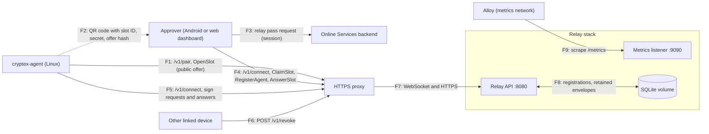

# Agent relay threat model

| Field                      | Value                                                                                     |
| -------------------------- | ----------------------------------------------------------------------------------------- |
| Product                    | Cryptex Vault agent relay (keyless SSH agent)                                             |
| Document revision          | 1.3                                                                                       |
| Updated                    | 20 October 2026                                                                           |
| Audience                   | Engineering and security reviewers                                                        |
| Status                     | Internal engineering review                                                               |
| Risk owners and acceptance | Milivoj Bošnjak (8l4cksmith) owns every risk below; acceptance requires an assigned owner |

## 1. Purpose and method

cryptex-agent runs on a Linux machine and acts as an ssh-agent that holds no private keys. When ssh, git or ssh-keygen asks it to sign, it sends the request through the agent relay to the device that paired it (the approver: the Android app or the web dashboard). The user approves there, the vault signs, and only the signature comes back.

The relay forwards end-to-end encrypted envelopes between an agent and its approver, keeps the registrations that say which agents belong to which approver, and runs the pairing slots that introduce a new agent to an approver. The same open-source server runs as the managed Online Services instance, where approvers present backend-signed relay passes, and as a self-hosted service with one operator access token.

This document uses the [OWASP threat modeling process](https://cheatsheetseries.owasp.org/cheatsheets/Threat_Modeling_Cheat_Sheet.html): describe the system, identify threats, record mitigations, and review the result. STRIDE classifies the threat scenarios.

This internal review covers the Go relay, its deployment files, and the protocol it shares with cryptex-agent and the approver (`agent.proto` and the envelope code). The backend's pass endpoint, the agent's local socket handling and the approver UI need their own reviews.

## 2. Scope and security objectives

### Scope

| In scope                                                                     | Outside this assessment                                               |
| ---------------------------------------------------------------------------- | --------------------------------------------------------------------- |
| `/v1/connect`, `/v1/pair` and `/v1/revoke`, the SQLite store and the sweeper | Online Services backend that signs relay passes (separate repository) |
| Relay pass verification (ML-DSA-65) and the access token check               | HTTPS proxy, CDN, and certificate management in front of the relay    |
| Envelope header checks, routing, queues, pairing slots and rate limits       | cryptex-agent's local socket, process inspection and state files      |
| Envelope format, pairing code, and the auth and revoke signatures            | Approver UI, vault storage of revocation keys, and SSH key handling   |
| Docker and Swarm deployment files for the relay                              | Prometheus, Alloy, and Grafana internals                              |

### Security objectives

1. The relay never receives private keys, data to be signed, signatures, or the process and host details in a request. Relay data alone must not let anyone sign with a user's SSH keys.
2. Only the paired approver can answer an agent, and only the paired agent can ask its approver. Envelopes the relay forges, alters or replays are refused by the recipient.
3. Only authorized approvers use the relay: Online Services subscribers with a valid pass, or holders of the operator's token. Agents can't use it without a registration made by an approver.
4. Pairing binds an agent to the approver that scanned its code, and the relay can't put itself or anyone else in the middle.
5. Revoking an agent takes effect on the relay at once, from any device that holds the vault.
6. Logs and metrics do not identify agents, approvers, accounts, or client addresses.

### Deployment assumptions and limits

- Clients reach the relay at its public URL (`RELAY_PUBLIC_URL`) through an HTTPS proxy that passes WebSocket upgrades through. Nothing else reaches the API port.
- The proxy terminates TLS and offers the hybrid post-quantum key exchange X25519MLKEM768. Without it, a future quantum computer could decrypt recorded TLS traffic. That would expose headers, passes and tokens, not envelope contents, which have their own post-quantum encryption.
- The proxy sets `X-Forwarded-For` (or `CF-Connecting-IP`), and `RELAY_TRUSTED_PROXY_HOPS` matches the number of proxies that append to it.
- Proxies keep idle WebSockets open for longer than `RELAY_KEEPALIVE_SECONDS`. Cloudflare drops them after 100 seconds, so the hosted relay announces 90.
- The managed instance trusts the backend's ML-DSA-65 public keys and its `aud` value. The backend issues passes only to subscribers' linked devices, and puts the relay key each device registered with it into the pass. It pins that key per device, so a pass for another key needs the device to be set up again. This repository can't verify that.
- One replica runs at a time on one node, because SQLite has one writer and the queues live in memory.
- Go's `crypto/hpke`, `crypto/ed25519`, cloudflare/circl and the noble libraries on the TypeScript side behave correctly for the operations used here.

This review does not establish compliance with a regulatory framework or deployment certification.

## 3. Assets and secret lifecycle

| ID  | Asset                                     | Location or lifetime                                                                                                                                           | Consequence of exposure                                                                           |
| --- | ----------------------------------------- | -------------------------------------------------------------------------------------------------------------------------------------------------------------- | ------------------------------------------------------------------------------------------------- |
| A1  | SSH private keys                          | Approver's vault; never sent to the agent or the relay                                                                                                         | Anyone holding them signs as the user                                                             |
| A2  | Agent and approver identity seeds         | Agent state file (0600) and approver vault; never sent to the relay                                                                                            | Impersonation of that side: asking for signatures, or answering them                              |
| A3  | Sign request contents                     | Encrypted in envelopes; the relay holds ciphertext for up to 90 seconds                                                                                        | Disclosure of what is signed, on which host, by which process                                     |
| A4  | Pairing secret (32 bytes, in the QR code) | Agent terminal and approver memory for one pairing; never sent to the relay                                                                                    | Anyone holding it while the slot is open can pair as the approver                                 |
| A5  | Revocation private keys                   | Approver's vault, synced to the user's linked devices                                                                                                          | Revoke the agent; nothing more                                                                    |
| A6  | Relay pass                                | Approver memory; reusable until it expires (7 days on the hosted relay)                                                                                        | Use the hosted relay as that account, within its agent limit                                      |
| A7  | Access token (token mode)                 | Operator env or Swarm secret; approver settings; agent state file                                                                                              | Use the self-hosted relay up to `RELAY_MAX_AGENTS`                                                |
| A8  | Registrations                             | SQLite `approvers`, `agents` and `revoked_agents`: public keys, revocation public keys, pass subject and device, times, and the approver behind each tombstone | Who is paired with whom, when they were last connected, and which agents were revoked; no secrets |
| A9  | Retained envelopes                        | SQLite `retained`, at most one per sender and recipient, until acked or 30 days                                                                                | Ciphertext of key lists and pairing confirmations; sizes and timing                               |
| A10 | Pairing offers                            | Relay memory while the slot is open (at most 6 minutes)                                                                                                        | Agent public keys and self-reported hostname, OS, architecture and version                        |
| A11 | Request metadata                          | Proxy logs, relay logs, rate-limiter memory, metrics                                                                                                           | Client addresses (rate limiters only), timing, frame counts                                       |

Keys and envelopes:

- Each side has an Ed25519 key (its ID on the relay and its envelope signature key) and an X-Wing (MLKEM768-X25519) key that envelopes are encrypted to.
- Envelopes use HPKE base mode with X-Wing, HKDF-SHA256 and ChaCha20-Poly1305. The serialized header (version, sender, recipient, 16-byte message ID, reply-to ID, expiry, retain flag) is the AAD, and Ed25519 signs a length-prefixed concatenation of header, encapsulated key and ciphertext.
- Requests expire after 90 seconds. Retained envelopes may live up to 30 days. 30 seconds of clock skew is tolerated everywhere.
- The approver creates a separate Ed25519 revocation key per agent and gives the relay only its public half.

## 4. Architecture and data flows

F2 never touches the network: the user scans the terminal's QR code with the approver, or pastes the code.

The relay joins one network shared with the HTTPS proxy and a metrics-only network that Alloy uses. It never joins the network that carries the backend's database and Redis.

## 5. Trust boundaries and attacker capabilities

| Boundary                                  | Flows          | Documented controls                                                                                               | Residual risk                                                              |
| ----------------------------------------- | -------------- | ----------------------------------------------------------------------------------------------------------------- | -------------------------------------------------------------------------- |
| B1: Clients and the internet-facing proxy | F1, F4, F5, F6 | HTTPS with hybrid PQ key exchange; challenge signatures bound to the relay origin; end-to-end envelope encryption | Proxy and CDN see metadata and client addresses                            |
| B2: Agent and approver, through the relay | F4, F5         | Keys pinned at pairing; signed and encrypted envelopes; expiry and replay checks on both ends                     | The relay can drop or delay envelopes                                      |
| B3: Agent terminal and approver           | F2             | Secret and offer hash travel only in the QR code; the pairing MAC proves the answer came from the code's holder   | Anyone who sees the code while the slot is open can pair first             |
| B4: Relay and its storage                 | F8             | Public keys, revocation public keys and ciphertext only                                                           | Database theft discloses who is paired with whom                           |
| B5: Backend and relay (passes)            | F3             | ML-DSA-65 signature, `kid`, `aud`, expiry, per-account agent limit                                                | Pass issuance and subscription checks are enforced outside this repository |
| B6: Monitoring and relay                  | F9             | Separate unpublished port; metrics-only network; no keys, IDs, subjects or addresses in labels                    | Anything on the relay's networks can read aggregate metrics                |

Relevant attackers include an internet client with no credentials, someone who sees a pairing QR code, a subscriber or token holder trying to exceed limits or reach other users' agents, someone with a stolen pass or token, an operator or intruder with the SQLite file, a compromised or malicious relay (including a self-hosted relay a user points their apps at), and malware running as the user on the agent machine.

## 6. Controls by operation

### Connecting (`/v1/connect`)

- The relay accepts only the `cryptex-agent.v1` subprotocol and binary messages. Until Auth succeeds a message may be 8 KiB, which fits an Auth with a pass; after that 68 KiB, the largest envelope plus room for the frame around it. Too large a message closes the socket.
- It refuses more than 120 upgrades per minute from one address, and answers HTTP 503 instead of upgrading while `RELAY_MAX_PENDING_CONNECTIONS` (1,000 by default) sockets are waiting for Auth. One address may hold 4 of those sockets and one network 64; beyond that the upgrade gets HTTP 429. Without the smaller caps a single client could hold the whole global cap and lock everyone else out.
- Per-address limits here and on `/v1/pair` and `/v1/revoke` count an IPv6 client by its /64 network, since one subscriber usually holds a whole /64. IPv4 addresses count one by one. Per-network limits count an IPv6 /48 or an IPv4 /24.
- It sends a Challenge with 32 random bytes. The client must answer within 5 seconds with an Ed25519 signature over `cryptex-relay-auth/v1`, the relay's own origin and the nonce. Binding the origin stops a malicious relay from passing another relay's challenge through.
- Auth names the role the client wants. Without one the relay refuses the connection.
- An agent must be registered by an approver first, and needs no pass. In token mode it must also present the token. An unknown agent key gets `REVOKED` if it was removed in the last 90 days and `NOT_FOUND` otherwise; the relay never records it as an approver.
- An approver needs a valid pass in ticket mode, or the token in token mode, compared as SHA-256 hashes in constant time. A key registered as an agent, or recorded under another account, is refused.
- Pass checks: ML-DSA-65 signature over `cryptex-relay-pass/v1.` plus the payload, known `kid`, `v = 1`, `aud` equal to the relay's origin, non-empty `sub`, `dev` and `jti`, `exp` after `iat`, 30 seconds of skew on both, an agent limit above zero, and a `key` that decodes (unpadded base64url) to 32 bytes. Passes are reusable until they expire.
- The pass's `key` must equal the key that signed Auth, and on RenewPass the connection's key. A pass copied off a device is useless without that device's private key.
- The relay keeps one approver per account and device (`sub` and `dev`). A pass for a new key on a known device, such as after the app was reinstalled, replaces the old approver: its agents are removed with tombstones and Revoked notices, as if unregistered, and its record goes. A pass for that device no newer than the one the current key showed is refused, so an old install can't take the device back.
- One live connection per key. A new one replaces the old, which gets "connected elsewhere". Queued envelopes are then delivered again to the new connection.
- The relay accepts any `Origin` header. Nothing relies on cookies or ambient credentials, so a cross-site page gains nothing it couldn't do from its own socket. The web approver needs this.
- A connection that sends nothing for twice the announced keep-alive plus 10 seconds is closed.

### Routing and queues

- For every Send, the relay parses the header, requires the sender to be the connection's key, verifies the Ed25519 signature, checks the expiry against its own clock and refuses a pairing MAC.
- An agent can send only to its approver, and an approver only to its own agents. Everything else gets `NOT_FOUND`. Once an approver's pass expires, sends from and to its agents get `UNAVAILABLE` until the device renews it.
- Envelopes over 64 KiB get `TOO_LARGE`.
- Requests wait in memory, at most 64 and 1 MiB per recipient (`LIMIT_REACHED` beyond), until the recipient acks them or they expire. An agent that has never authenticated may hold one request next to its retained KeysUpdate, so made-up agent keys that nobody will ever collect for can't be used as storage.
- Everything held in memory, retained envelopes included, counts against two budgets. Each account gets `RELAY_MAX_ACCOUNT_QUEUE_BYTES` (4 MiB by default), counting envelopes both ways between its approvers and their agents; sends beyond it get `LIMIT_REACHED`. The account is the pass subject in ticket mode. In token mode it is the approver key, because one buggy client shouldn't take the whole relay even though one token is one owner. The whole relay gets `RELAY_MAX_QUEUE_BYTES` (64 MiB by default); sends beyond it get `UNAVAILABLE`. With the defaults it takes 16 accounts to fill the relay.
- Message IDs are remembered until expiry and duplicates are refused, so replaying a captured envelope through the relay fails even after it was acked. The relay remembers at most 1,024 per sender and recipient, so one agent sending as fast as it can doesn't block the other agents of its approver. Before refusing a sender at that cap the relay drops the recipient's expired envelopes, and counts them as expired like the sweeper does.
- Retained envelopes go to SQLite. A newer one from the same sender to the same recipient replaces the older one, so each pair holds at most one. A recipient may hold at most one per sender that can reach it: an agent one, an approver one per agent.
- A client that falls 256 frames behind is disconnected rather than buffered; unacked envelopes come back when it reconnects. That backlog is written one envelope at a time with a write deadline, outside the 256-frame buffer, so a recipient with a long backlog isn't dropped on every reconnect.
- The relay's checks only keep junk out of queues. Recipients verify the sender against the key they pinned at pairing, decrypt, check expiry, and refuse message IDs they have seen.

### Pairing (`/v1/pair`)

- No authentication. Per address: at most 20 upgrades per minute, refused with HTTP 429 before upgrading, 2 open pairing sockets and 10 slot openings per 10 minutes. Per network: at most 16 open pairing sockets. At most `RELAY_MAX_PAIRING_SLOTS` sockets on the whole relay. Messages are at most 8 KiB and the offer at most 4 KB.
- The Challenge comes first on every socket. A socket over the limits gets an Error after it and is closed.
- The agent must open its slot within 5 seconds of the Challenge. The offer must parse as a version 1 PairingOffer with a 32-byte Ed25519 key and a 1216-byte X-Wing key. One slot per socket; besides OpenSlot only Ping is accepted.
- Slot IDs are 16 random bytes. A slot lasts 3 minutes until an approver claims it, then 3 minutes from the claim. Closing the socket deletes the slot at once, and expiry closes the socket.
- The first approver to claim a slot owns it. Others get `ALREADY_CLAIMED`.
- The approver checks the offer against the hash in the QR code, registers the agent, and answers with an envelope addressed to the offer's key, signed by the approver and carrying an HMAC keyed from the pairing secret. The relay checks the addressing, signature, expiry, the MAC's length, and that the agent is registered under this approver; the agent checks the MAC itself.
- A relay that swaps the offer fails the hash check on the approver; one that swaps the answer can't produce the MAC.
- Once the answer opens, the agent and the approver each show a confirmation code (such as `CP22-34W6`) computed from the offer hash and the approver's signing and X-Wing keys. The agent saves nothing and sends no PairingConfirm until the user presses Enter to confirm the codes match. Cancelling unregisters the agent from the approver that answered. If someone else claimed the slot first, the user's phone has no matching code to show, and the user cancels.

### Registrations and limits

- Only approvers register agents, with a 32-byte agent key and a 32-byte revocation key. An agent registered under another approver gets `ALREADY_CLAIMED`.
- Each approver key may send 30 RegisterAgent and 30 UnregisterAgent frames per minute, counted across reconnects; more get `RATE_LIMITED`. Pairing registers one agent at a time, so only churn hits the limit. An agent removing itself is not limited, since that ends its connection.
- Ticket mode counts agents per account (`sub`) across its approving devices whose pass is still valid, against the agent limit of the account's newest pass. A device whose pass lapsed keeps its agents for the grace period, but they don't block a new device. Token mode counts all agents on the relay against `RELAY_MAX_AGENTS`, because one token is one owner.
- RenewPass needs a pass for the same account and the connection's key. An older pass sent later doesn't lower the expiry or limit.
- An approver whose last pass expired more than `RELAY_REGISTRATION_GRACE_DAYS` (30 by default) ago is deleted with its agents. Routing stopped when the pass expired; the grace period only lets a device that stayed locked for a while resume without pairing every agent again.

### Revoking

- An approver unregisters one of its agents, or an agent unregisters itself, over the connection.
- `POST /v1/revoke` takes a protobuf RevokeRequest of at most 1 KiB, signed by the agent's revocation key over `cryptex-relay-revoke/v1`, the relay's origin, the agent key and `issued_at`. The origin binding means a request sent to one relay can't be replayed on another. The relay accepts `issued_at` within 5 minutes of its clock and allows 30 requests per minute per address. Any device holding the vault can revoke an agent, even when the approver is offline.
- Revoking deletes the registration, the agent's queues and every retained envelope to or from it, sends Revoked to the agent and closes it, and tells the approver if it is online. A replayed request finds no agent and gets 404.
- Every removal (by the approver, by the agent, over `/v1/revoke`, by a reinstall on the same device, or by the grace-period sweep) of an agent that authenticated at least once leaves a tombstone with the agent key, its approver and the time for 90 days, so an agent that was offline learns it was revoked. An agent that never authenticated was never online to miss its removal, and leaves none. Registering the key again clears it.
- Each approver key keeps at most 1,000 tombstones; the oldest go first. Together with the registration limit this bounds what churn can add to the database.
- Approvers don't take the relay's word for a revocation. An agent missing from Ready, or a Revoked frame, only marks the agent "the relay no longer knows this agent" on that device; the synced vault record stays until the user revokes it. A relay that lost its database, or a hostile one, can't remove agents from the user's vault.
- A device that revokes writes the synced deletion even when it can't reach the relay. The approving device then unregisters the agent over its own connection when it sees the deletion.
- Approvers and agents reach a relay only over HTTPS, `/v1/revoke` included; plain HTTP works only for `localhost`, `127.0.0.1` and `[::1]`, for development. The agent doesn't follow redirects, so a relay can't forward its Auth elsewhere. The web app's connect-src allows `https:` for this, so any browser can revoke an agent paired on a self-hosted relay.

### Logging and metrics

- Logs record the endpoint, the role, why a connection ended, durations, and the status of revoke requests. They don't record keys, slot IDs, pass subjects or client addresses.
- Metrics are served on a separate listener (`:9090` by default, `RELAY_METRICS_ADDR=off` disables it) that is never published or proxied. In Swarm it sits on a metrics-only network.
- Metric labels come from fixed sets: roles, frame types, statuses, outcomes and sources.

### Deployment

- The image is distroless and runs as a non-root user. The binary checks its own health.
- HTTP responses send `Cache-Control: no-store`, `X-Content-Type-Options: nosniff` and `Referrer-Policy: no-referrer`. `/v1/revoke` allows any origin for the web approver.
- The relay refuses to start without a public URL it can reduce to an origin, without pass keys in ticket mode, or with a token shorter than 32 characters.

## 7. Threat scenarios and existing risk register

STRIDE categories are spoofing, tampering, repudiation, information disclosure, denial of service, and elevation of privilege.

| ID  | STRIDE                           | Scenario and affected assets                                                                                             | Boundary | Existing controls                                                                                                                                                                                              | Residual risk or review need                                                              |
| --- | -------------------------------- | ------------------------------------------------------------------------------------------------------------------------ | -------- | -------------------------------------------------------------------------------------------------------------------------------------------------------------------------------------------------------------- | ----------------------------------------------------------------------------------------- |
| T1  | Information disclosure           | Operator or intruder reads relay memory or the database (A3, A8, A9)                                                     | B4       | End-to-end encryption; only public keys and ciphertext stored; requests in memory only                                                                                                                         | Pairing graph, hostnames in open offers, timing                                           |
| T2  | Spoofing, tampering              | Malicious relay forges or alters an envelope to get a signature or fake one                                              | B2       | Keys pinned at pairing; Ed25519 over header and ciphertext; AEAD with the header as AAD                                                                                                                        | None known                                                                                |
| T3  | Tampering                        | Malicious relay replays a request or an approval                                                                         | B2       | Message IDs, 90-second expiry, reply-to matching, seen-ID checks on both ends                                                                                                                                  | A replayed request inside its 90 seconds shows the user a second prompt they can deny     |
| T4  | Spoofing                         | Malicious relay inserts itself into pairing                                                                              | B3       | Offer hash in the QR code; pairing MAC keyed by a secret the relay never sees                                                                                                                                  | None known                                                                                |
| T5  | Spoofing                         | Someone who sees the QR code claims the slot first and pairs as the approver                                             | B3       | First claim wins; the user's app sees the claim fail; the agent shows a confirmation code over the offer and the approver's keys and saves nothing until the user confirms it matches their phone              | A user who confirms without comparing the codes can still pair with the wrong approver    |
| T6  | Denial of service                | Malicious relay drops or delays envelopes                                                                                | B2       | Requests time out after 90 seconds and fail closed                                                                                                                                                             | SSH stops working; no signature is ever produced without approval                         |
| T7  | Spoofing, elevation of privilege | Non-subscriber uses the hosted relay                                                                                     | B5       | Signed passes with audience, expiry and agent limit                                                                                                                                                            | Backend issuance and subscription checks are external                                     |
| T8  | Elevation of privilege           | A relay user reaches another user's agents or approver                                                                   | B1       | Routing allows only registered pairs; registration is first-come and refuses another approver's agent                                                                                                          | None known                                                                                |
| T9  | Spoofing                         | Stolen pass (A6) used to register approvers and agents on the victim's account                                           | B1, B5   | Passes name the approver key and Auth needs its signature; pass lifetime; per-account agent limit                                                                                                              | Someone holding both the pass and the device's relay key can use the account until expiry |
| T10 | Spoofing                         | Leaked access token (A7) on a self-hosted relay                                                                          | B1       | Can't reach other approvers' agents; `RELAY_MAX_AGENTS`                                                                                                                                                        | Rotating the token means pairing every agent again                                        |
| T11 | Denial of service                | Floods of pairing sockets, connections, frames, envelopes or revoke requests                                             | B1       | Per-address, per-network (/48, /24) and global caps, IPv6 grouped by /64, read limits, caps on sockets before Auth, auth and idle timeouts, queues capped by count and bytes, bounded limiter keys             | Limits are per replica; address pools larger than a few networks dilute them              |
| T12 | Spoofing                         | Client fakes `X-Forwarded-For` to dodge rate limits                                                                      | B1       | Entries counted from the right by trusted hops; non-IP values ignored                                                                                                                                          | A wrong hop count re-opens spoofing                                                       |
| T13 | Tampering                        | Cross-site page opens a WebSocket to the relay from a user's browser                                                     | B1       | No cookies or ambient credentials; every action needs a signature by a key the page doesn't have                                                                                                               | None known                                                                                |
| T14 | Denial of service                | Attacker revokes agents                                                                                                  | B1       | Revoke needs the revocation private key, the approver's or the agent's own connection                                                                                                                          | A compromised linked device can revoke the user's agents                                  |
| T15 | Information disclosure           | Logs or metrics identify users                                                                                           | B6       | No keys, IDs, subjects or addresses in logs or labels                                                                                                                                                          | Proxy and CDN logs are outside this model                                                 |
| T16 | Denial of service                | Swarm reschedules the relay to another node                                                                              | B4       | Placement constraint on a labelled node; `stop-first` updates                                                                                                                                                  | Node loss loses registrations; every agent must be paired again                           |
| T17 | Elevation of privilege           | Malware running as the user on the agent machine asks for signatures                                                     | B2       | Every request shows the process chain and host from session-bind; the user approves each one                                                                                                                   | Outside the relay: the user must read the prompt                                          |
| T18 | Denial of service                | A subscriber or token holder registers agents nobody runs and queues envelopes for them until the relay's budget is full | B1       | Per-account queue budget; one request for an agent that never authenticated; per-sender seen-ID cap; register and unregister limits; tombstones only for agents that authenticated, at most 1,000 per approver | Many accounts together can still fill `RELAY_MAX_QUEUE_BYTES`                             |

Repudiation is not addressed by design: the relay keeps no record of requests or approvals. The approver may keep its own history.

### Open risks

Priorities are qualitative engineering judgments, not CVSS scores.

| ID  | Priority | Risk                                                                                                         | Status                    | Owner                        | Next action                                                                                       |
| --- | -------- | ------------------------------------------------------------------------------------------------------------ | ------------------------- | ---------------------------- | ------------------------------------------------------------------------------------------------- |
| R1  | Medium   | A leaked pass signing seed lets anyone mint passes until the key is rotated                                  | Documented                | Milivoj Bošnjak (8l4cksmith) | Keep the seed in Docker secrets, one per environment; rotate by key ID                            |
| R2  | Medium   | A wrong `RELAY_TRUSTED_PROXY_HOPS` lets clients choose their rate-limit address                              | Documented                | Milivoj Bošnjak (8l4cksmith) | Add a deployment check that compares the header seen by the relay with the proxy's address        |
| R3  | Medium   | Token mode has one token for every client, kept in each agent's state file; rotating it re-pairs every agent | Accepted for self-hosting | Milivoj Bošnjak (8l4cksmith) | Revisit per-approver tokens if self-hosted relays grow beyond one owner                           |
| R4  | Low      | A pass stays valid for its lifetime after the device is removed or the subscription lapses                   | Accepted                  | Milivoj Bošnjak (8l4cksmith) | Keep pass lifetimes short (7 days, renewed on unlock)                                             |
| R5  | Low      | Rate limits, queues and pairing slots are per replica and in memory; restarts reset them and drop requests   | Accepted for one replica  | Milivoj Bošnjak (8l4cksmith) | Revisit if the relay ever runs more than one replica                                              |
| R6  | Low      | The relay sees who is paired with whom, when requests happen, and the hostname in open pairing offers        | Accepted                  | Milivoj Bošnjak (8l4cksmith) | None; the offer is shown to the user as unverified anyway                                         |
| R7  | Low      | A pairing QR code seen by someone else can be claimed before the user's device                               | Mitigated                 | Milivoj Bošnjak (8l4cksmith) | The confirmation code catches it if the user compares; keep the code on screen only while pairing |
| R8  | Low      | Clients that reach the relay port without the HTTPS proxy choose their rate-limit address                    | Documented                | Milivoj Bošnjak (8l4cksmith) | Keep port 8080 unpublished; publish only through the proxy network                                |
| R9  | Low      | A newer pass for a device with another key removes that device's agents; the relay trusts the backend here   | Mitigated in the backend  | Milivoj Bošnjak (8l4cksmith) | The backend pins the relay key per device; verify that in the backend's review                    |
| R10 | Low      | The web app's connect-src allows `https:` to any host so any browser can revoke on a self-hosted relay       | Accepted                  | Milivoj Bošnjak (8l4cksmith) | None; connect-src already allowed `ws:` and `wss:` to any host, so injected script gains nothing  |
| R11 | Low      | Two unlocked dashboard tabs would each save their own copy of the vault and approve from a stale one         | Mitigated                 | Milivoj Bošnjak (8l4cksmith) | The vault stays unlocked in one tab per browser (Web Lock); another tab offers "Use here"         |

## 8. External services and privacy

| Service                    | Purpose                     | Visible data or metadata                                                              |
| -------------------------- | --------------------------- | ------------------------------------------------------------------------------------- |
| Online Services backend    | Signs relay passes          | That a device requested a pass, and when; never agents, keys or requests              |
| HTTPS proxy or CDN         | TLS termination and routing | Client addresses, connection timing and sizes; with TLS terminated, passes and tokens |
| Alloy, Prometheus, Grafana | Metrics collection          | Aggregate counts; no keys, IDs, subjects or addresses                                 |

## 9. Review and validation

Review this model when the envelope format, pairing flow, pass format, authentication modes, routing rules, limits, retention, logging, metrics, proxy setup, or deployment topology changes.

Evidence for the current revision:

- Go tests with an in-process relay and a frame-level test client for: auth (bad signature, wrong origin, expired pass, wrong audience, unknown key ID, token mismatch, another account's key, missing or mismatched role), tombstones for every kind of removal, routing between approvers and agents, queue, ack and redelivery after reconnect, retained replacement across a restart, expiry, pass expiry and renewal, the registration grace sweep, agent limits per account and in token mode, the pairing slot lifecycle (second claim, rival approver, expiry, socket close, answer before RegisterAgent), revoke over HTTP including key rotation, replaced connections, the keep-alive timeout, rate limits, and metrics labels. Also: a stolen pass presented with another key (Auth and RenewPass), a reinstall replacing the old approver, the agent limit ignoring lapsed devices, an envelope at and one byte over the size limit, the read limit before Auth, the cap on sockets waiting for Auth, the per-recipient and global queue byte caps, the retained cap per recipient, a backlog larger than the outbound buffer, and IPv6 /64 grouping of rate-limit keys. Also: the per-account queue budget in both modes; three accounts with 25 made-up agents each, signed in or not, staying within their budgets while another account's sends still work; the small queue of an agent that never authenticated, across a restart; one agent flooding its approver without blocking another agent, with the dropped envelopes counted; pending socket caps per address and per network for IPv4 and IPv6; the 5-second auth timeout; pairing socket caps per network and the upgrade limit before the WebSocket handshake; register and unregister limits across reconnects; no tombstones for agents that never authenticated; the tombstone cap per approver; and the tombstone column migration.
- Go and Jest tests for the envelope, pairing code, confirmation code and auth and revoke signatures against shared vectors.

End-to-end runs with cryptex-agent, the test approver and an OpenSSH server are planned for the next step.

## 10. References

All paths below are relative to this document.

- [Server entry point](main.go), [server](../../internal/relay/server.go), [WebSocket connections](../../internal/relay/peer.go), [/v1/connect](../../internal/relay/connect.go), [Auth and passes](../../internal/relay/auth.go), [registrations](../../internal/relay/registry.go), [routing](../../internal/relay/route.go), [queues](../../internal/relay/mailbox.go), [pairing slots](../../internal/relay/pair.go), [revoke](../../internal/relay/revoke.go), [pass verification](../../internal/relay/pass.go), [sweepers](../../internal/relay/sweep.go), [store](../../internal/relay/store.go), and [metrics](../../internal/relay/metrics.go).
- [Protocol](../../../packages/vault-core/src/proto/agent.proto) and [envelope, pairing and relay signatures](../../internal/agentproto/envelope.go).
- [Swarm stack](compose.swarm.yaml) and [Swarm deployment guide](../../../docs/swarm-deployment.md).
- [Share server threat model](../share-server/threat-model.md), which shares the pass key format, rate limiter and client address handling.
