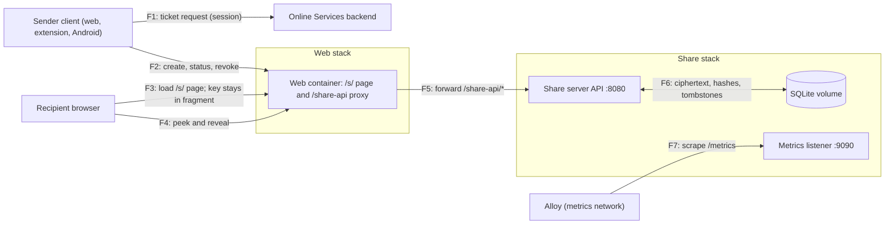

# Share server threat model

| Field                      | Value                                                                   |
| -------------------------- | ----------------------------------------------------------------------- |
| Product                    | Cryptex Vault share server (one-time share links)                       |
| Document revision          | 1.1                                                                     |
| Updated                    | 14 October 2026                                                         |
| Audience                   | Engineering and security reviewers                                      |
| Status                     | Internal engineering review                                             |
| Risk owners and acceptance | Unassigned unless recorded below; acceptance requires an assigned owner |

## 1. Purpose and method

The share server stores one-time share links. A sender encrypts a secret in their Cryptex Vault client, uploads the ciphertext, and sends a link to someone without a vault. The recipient opens the link once; the server deletes the ciphertext as it hands it over. The decryption key lives in the link fragment, which browsers never send to a server.

The same open-source server runs as the managed Online Services instance, where subscribers create links with backend-signed tickets, and as a self-hosted service, where an operator hands out creation tokens.

This document uses the [OWASP threat modeling process](https://cheatsheetseries.owasp.org/cheatsheets/Threat_Modeling_Cheat_Sheet.html): describe the system, identify threats, record mitigations, and review the result. STRIDE classifies the threat scenarios.

This internal review covers the Go server, its deployment files, and the client code that talks to it. Code references identify the implementations relevant to each control. The backend's ticket endpoint and the deployed infrastructure require separate validation.

## 2. Scope and security objectives

### Scope

| In scope                                                                | Outside this assessment                                                    |
| ----------------------------------------------------------------------- | -------------------------------------------------------------------------- |
| Share API, SQLite store, sweeper, rate limiter, and metrics listener    | Online Services backend that signs tickets (separate repository)           |
| Ticket verification (ML-DSA-65) and creation-token checks               | HTTPS proxy, CDN, and certificate management in front of the web container |
| Share envelope, link format, and token derivation in shared client code | Chat, email, or other channels used to deliver links                       |
| Recipient page `/s/<id>` and the web container's `/share-api/*` proxy   | Recipient devices, browsers, and extensions                                |
| Sender-side records (Shared links list) and their sync rules            | Sender vault internals, covered by the client threat models                |
| Docker Compose and Swarm deployment files for the share server          | Prometheus, Alloy, and Grafana internals                                   |

### Security objectives

1. The server never receives a share's plaintext or decryption key. Server data alone must not decrypt any share.
2. A share can be opened at most once. Opening, revoking, expiry, or too many wrong passphrases removes the ciphertext.
3. Only authorized senders create shares: Online Services subscribers with a valid ticket, or holders of an operator's creation token.
4. Without the link, nobody can tell whether a share exists, read it, or burn it. Without the sender's manage token, nobody can revoke it or read its status.
5. Server logs and metrics do not identify shares, senders, or recipients.

### Deployment assumptions and limits

- Clients reach the API at `/share-api/v1` on the web origin. The web container forwards those requests to the share server. Nothing else reaches the API port.
- An HTTPS proxy terminates TLS and offers the hybrid post-quantum key exchange X25519MLKEM768. Without it, a future quantum computer could decrypt recorded TLS traffic. That would expose tokens and metadata, not share contents, because the envelope key never crosses the network.
- The proxy sets `X-Forwarded-For` (or `CF-Connecting-IP`), and `SHARE_TRUSTED_PROXY_HOPS` matches the number of proxies that append to it.
- The managed instance trusts the backend's ML-DSA-65 public key and its `aud` value. The backend issues tickets only to subscribers. This repository can't verify that.
- One replica runs at a time on one node, because SQLite has one writer.
- Web Crypto, libsodium (Argon2id), and cloudflare/circl behave correctly for the operations used here.

This review does not establish compliance with a regulatory framework or deployment certification.

## 3. Assets and secret lifecycle

| ID  | Asset                                 | Location or lifetime                                                                | Consequence of exposure                                                         |
| --- | ------------------------------------- | ----------------------------------------------------------------------------------- | ------------------------------------------------------------------------------- |
| S1  | Shared plaintext                      | Sender client while creating; recipient page memory after reveal                    | The shared credential or text is disclosed                                      |
| S2  | Link secret (32 bytes, URL fragment)  | Link in transit and wherever the link is stored; never sent to the server           | Anyone holding it can open the share once, or burn it                           |
| S3  | Share passphrase (optional)           | Sender and recipient; never stored                                                  | With S2, opens a passphrase share                                               |
| S4  | Share ciphertext                      | SQLite `shares.ciphertext` until opened, revoked, burned, or expired                | Useless without S2; size and timing disclosed                                   |
| S5  | Peek, reveal, and manage token hashes | SQLite until the tombstone is forgotten (30 days after the share ends by default)   | Hashes of high-entropy tokens; with S2, an offline passphrase-guessing target   |
| S6  | Manage token                          | Sender's encrypted vault, synced between the sender's devices                       | Revoke the share and read its status and viewing time                           |
| S7  | Subscriber ticket                     | Client memory for one request; `used_tickets` keeps its ID until expiry (5 minutes) | One share created on the subscriber's quota                                     |
| S8  | Creation tokens                       | Operator env or Swarm secret (SHA-256 hashes in memory); users' vault settings      | Shares created on the operator's server until the token is removed              |
| S9  | Ticket subject (`sub`)                | Ticket and SQLite `shares.owner`                                                    | Pseudonym that links shares from one account; not the account ID                |
| S10 | Request metadata                      | Proxy and server logs, rate-limiter memory, metrics                                 | Client addresses (rate limiter only), route patterns, timing, and status counts |

Key derivation for a share:

- The link secret is 32 random bytes. HKDF-SHA-256 with the labels `cryptex/share/v1|enc`, `|peek`, and `|reveal` derives the AES-256-GCM key, the peek token, and the reveal token.
- With a passphrase, Argon2id (64 MiB, 3 passes, salt derived from the secret with the label `|passphrase-salt`) produces a key that becomes the HKDF salt for the encryption key and the reveal token. The peek token never depends on the passphrase, so the recipient page can learn whether one is needed.
- The envelope is a version byte, a flags byte, a 12-byte nonce, and the AES-GCM output. The two header bytes are the additional data.
- The manage token is 32 independent random bytes. The server stores only SHA-256 of the peek, reveal, and manage tokens.

## 4. Architecture and data flows

The web container and the share server share one overlay network. The share server also joins a metrics-only network that Alloy uses. It never joins the network that carries the backend's database and Redis.

## 5. Trust boundaries and attacker capabilities

| Boundary                                  | Flows      | Documented controls                                                                                   | Residual risk                                                                                   |
| ----------------------------------------- | ---------- | ----------------------------------------------------------------------------------------------------- | ----------------------------------------------------------------------------------------------- |
| B1: Clients and the internet-facing proxy | F2, F3, F4 | HTTPS with hybrid PQ key exchange; fragment never sent; strict CSP and `no-referrer` on `/s/*`        | Proxy and CDN see metadata; a link stolen in transit opens the share                            |
| B2: Web container and share server        | F5         | Only `/share-api/*` is forwarded; header passed through unchanged; no other route reaches the API     | A compromised web container can tamper with the recipient page and read secrets as they display |
| B3: Share server and its storage          | F6         | Ciphertext only; token hashes; ciphertext deleted on reveal, revoke, burn, or expiry                  | Database theft discloses ciphertext sizes, timing, and token hashes                             |
| B4: Backend and share server (tickets)    | F1         | ML-DSA-65 signature, `kid`, `aud`, 5-minute expiry, single-use `jti`, limits that can only lower caps | Ticket issuance and subscription checks are enforced outside this repository                    |
| B5: Monitoring and share server           | F7         | Separate unpublished port; metrics-only network; no IDs, subjects, or addresses in labels             | Anything on the share server's networks can read aggregate metrics                              |

Relevant attackers include someone who intercepts or finds a link, a link-preview bot, an internet client without a link, a subscriber or token holder trying to exceed limits, someone with a stolen ticket or creation token, an operator or intruder with the SQLite file, a compromised web container, and a malicious self-hosted server the sender's client points at.

## 6. Controls by operation

### Create

- Ticket mode: `Authorization: Ticket <payload>.<signature>`. The server checks the ML-DSA-65 signature over `cryptex-share-ticket/v1.` plus the payload, the key ID, `v = 1`, `aud` against its own origin, `iat`/`exp` with 30 seconds of clock skew, and non-zero limits.
- The ticket's `jti` goes into `used_tickets` in the same transaction as the share, and the expiry is checked again inside that transaction. A ticket creates one share.
- Ticket limits (`active`, `bytes`, `ttl`) can only lower the server's own caps. The managed defaults are 200 active shares per account, 64 KiB per share, and 7 days.
- Token mode: `Authorization: Bearer <token>`. Tokens are at least 32 characters. The server keeps SHA-256 hashes and compares them in constant time. Each token is its own owner for the active-share limit.
- The request must carry three 32-byte SHA-256 token hashes, a TTL between 60 seconds and the cap, and ciphertext within the size cap. The body limit follows the size cap.
- Clients read `aud` from a ticket before sending it and refuse to send it to any other server.

### Peek and reveal

- Peek takes the peek token and answers only whether a passphrase is needed and when the share expires. A missing share, a finished share, and a wrong token all return the same `gone` answer.
- Reveal takes the peek and reveal tokens. In one transaction the server checks both, returns the ciphertext, and replaces it with `NULL`, marking the share viewed.
- A wrong reveal token counts as a failed passphrase attempt. After five, the share burns and the server deletes its ciphertext.
- The recipient page asks for a click before revealing, so link previewers only ever peek.
- The page removes the fragment from the address bar after reveal, sends no referrer, and runs under a CSP with `default-src 'none'`, scripts from its own origin only, and `frame-ancestors 'none'`.

### Status and revoke

- Both take the manage token. Status answers up to 200 shares per request and reports `unknown` for both missing shares and wrong tokens.
- Revoke deletes the ciphertext of an open share and reports the resulting status. A share opened just before the revoke keeps reporting `viewed`, so the sender learns it was seen.

### Expiry and retention

- The sweeper runs every minute. It deletes ciphertext from expired shares, forgets finished shares after `SHARE_TOMBSTONE_DAYS` (30 by default), and clears expired ticket IDs.
- Senders' clients prune ended records from their list about 90 days after they learn that a link ended. Those records are synced vault data, encrypted like the rest of the vault.

### Abuse limits

- Per-address fixed-window limits: 30 creates, 30 opens (peek and reveal), and 60 status or revoke requests per minute.
- The client address is taken `SHARE_TRUSTED_PROXY_HOPS` entries from the right of the configured header, must parse as an IP address, and otherwise falls back to the socket address.
- The limiter keeps at most 100,000 addresses. Beyond that, new clients share one overflow bucket.
- Request bodies are capped, unknown JSON fields are rejected, and share IDs must match a fixed 22-character pattern before any lookup.

### Logging and metrics

- Request logs record the method, the route pattern (not the path, which contains share IDs), the status, and the duration. They don't record client addresses.
- Metrics are served on a separate listener (`:9090` by default, `SHARE_METRICS_ADDR=off` disables it) that is never published or proxied. In Swarm it sits on a metrics-only network.
- Metric labels use route patterns, a fixed set of methods, event names, and reasons. They never carry share IDs, subjects, tokens, or addresses.

### Deployment

- The image is distroless and runs as a non-root user. The binary checks its own health.
- API responses send `Cache-Control: no-store`, `X-Content-Type-Options: nosniff`, and `Referrer-Policy: no-referrer`. CORS allows any origin because no cookies are involved. The extension and self-hosted web apps need that.
- In ticket mode the server refuses to start without a valid audience, taken from `SHARE_TICKET_AUDIENCE` or else `NEXT_PUBLIC_APP_URL` and reduced to an origin.

## 7. Threat scenarios and existing risk register

STRIDE categories are spoofing, tampering, repudiation, information disclosure, denial of service, and elevation of privilege.

| ID  | STRIDE                            | Scenario and affected assets                                                                              | Boundary | Existing controls                                                                                          | Residual risk or review need                                                                                                  |
| --- | --------------------------------- | --------------------------------------------------------------------------------------------------------- | -------- | ---------------------------------------------------------------------------------------------------------- | ----------------------------------------------------------------------------------------------------------------------------- |
| T1  | Information disclosure            | Someone intercepts the link (S2) and opens it before the recipient                                        | B1       | One view; optional passphrase; the recipient sees "gone" and the sender sees "Opened"                      | Detection only, after the fact; the delivery channel is outside this model                                                    |
| T2  | Information disclosure            | Operator or intruder reads the database (S4, S5)                                                          | B3       | Ciphertext only; tokens stored as hashes; ciphertext deleted when a share ends                             | With a link as well, offline passphrase guessing against Argon2id                                                             |
| T3  | Spoofing, elevation of privilege  | Non-subscriber creates shares on the managed server                                                       | B4       | Signed tickets with audience, expiry, and single use                                                       | Backend issuance and subscription checks are external                                                                         |
| T4  | Spoofing                          | Ticket replayed, or reused at another server                                                              | B4       | `jti` single use inside the create transaction; `aud` check on the server; client checks `aud` before send | Separate signing keys per environment are an operational assumption                                                           |
| T5  | Denial of service                 | Link-preview bot or attacker burns a share before the recipient                                           | B1       | Previews only peek; reveal needs a click and the reveal token; burning needs the link                      | Anyone with the link can burn a passphrase share with five wrong guesses                                                      |
| T6  | Information disclosure            | Attacker without a link probes for shares or statuses                                                     | B1       | 128-bit IDs; identical `gone` and `unknown` answers; constant-time hash comparison                         | None known                                                                                                                    |
| T7  | Denial of service                 | Floods of requests or creates exhaust memory, disk, or the database writer                                | B1, B3   | Per-address limits; bounded limiter; per-owner active cap; size and TTL caps; body limits                  | Limits are per replica and per address; large address pools dilute them                                                       |
| T8  | Spoofing                          | Client fakes `X-Forwarded-For` to dodge rate limits                                                       | B1, B2   | Entries counted from the right by trusted hops; non-IP values ignored                                      | Wrong hop count in a deployment re-opens spoofing                                                                             |
| T9  | Tampering, information disclosure | Compromised web container serves a modified recipient page that leaks the fragment                        | B2       | Image pinning and release process; strict CSP limits third-party loading                                   | The recipient page is trusted code; this is inherent to browser-delivered crypto                                              |
| T10 | Tampering, information disclosure | A malicious self-hosted server (configured in a sender's client) serves a page that reads the link secret | B1       | Server stores only ciphertext; managed-server tickets are never sent to it                                 | Links on a custom server are only as trustworthy as that server's web app                                                     |
| T11 | Information disclosure            | Logs or metrics identify shares, senders, or recipients                                                   | B5       | Route patterns only; no addresses in logs; bounded labels                                                  | Proxy and CDN logs are outside this model                                                                                     |
| T12 | Elevation of privilege            | Compromised share server reaches other backend services                                                   | B5       | Separate stack; metrics-only network; no database or Redis access                                          | The share server shares a network with the web container                                                                      |
| T13 | Denial of service                 | Swarm reschedules the share server to another node                                                        | B3       | Placement constraint on a labelled node; `stop-first` updates                                              | Node loss means open links stop working; shares are short-lived                                                               |
| T14 | Tampering                         | A sender's synced share records are altered by a malicious device or replayed                             | B1       | Records are vault data; tombstones stay deleted; server and manage token can't change once set             | A compromised sender device can revoke the sender's shares, or sync records that make other devices contact a server it picks |

Repudiation is not addressed by design: the server keeps no record of who created or opened a share beyond the owner pseudonym and timestamps.

### Open risks

Priorities are qualitative engineering judgments, not CVSS scores.

| ID  | Priority | Risk                                                                                                                            | Status                   | Owner      | Next action                                                                                 |
| --- | -------- | ------------------------------------------------------------------------------------------------------------------------------- | ------------------------ | ---------- | ------------------------------------------------------------------------------------------- |
| R1  | Medium   | A leaked ticket signing seed lets anyone mint tickets until the key is rotated                                                  | Documented               | Unassigned | Keep the seed in Docker secrets, one per environment; rotate by key ID                      |
| R2  | Medium   | A wrong `SHARE_TRUSTED_PROXY_HOPS` lets clients choose their rate-limit address                                                 | Documented               | Unassigned | Add a deployment check that compares the header seen by the server with the proxy's address |
| R3  | Low      | Rate limits are per replica and in memory; restarts reset them                                                                  | Accepted for one replica | Unassigned | Revisit if the server ever runs more than one replica                                       |
| R4  | Low      | Aggregate metrics are readable from the web container's network too                                                             | Accepted                 | Unassigned | Add a subnet allowlist if metrics ever carry sensitive labels                               |
| R5  | Low      | Anyone with a link can burn a passphrase share with five wrong guesses                                                          | Accepted                 | Unassigned | None; the sender can create a new link                                                      |
| R6  | Medium   | Clients that reach the web container without the HTTPS proxy choose their rate-limit address                                    | Documented               | Unassigned | Keep the web port unpublished or firewalled; development uses the socket address            |
| R7  | Low      | A compromised linked device can sync a share record naming any server; opening Shared links then sends its status request there | Accepted                 | Unassigned | None; a linked device already holds the whole vault                                         |

## 8. External services and privacy

| Service                    | Purpose                                         | Visible data or metadata                                                              |
| -------------------------- | ----------------------------------------------- | ------------------------------------------------------------------------------------- |
| Online Services backend    | Signs subscriber tickets                        | That an account requested a ticket, and when; never the share, link, or key           |
| HTTPS proxy or CDN         | TLS termination and routing                     | Client addresses, paths with share IDs, sizes, and timing                             |
| Alloy, Prometheus, Grafana | Metrics collection                              | Aggregate counts and durations; no IDs, subjects, or addresses                        |
| Link delivery channel      | Chat, email, or other messaging chosen by users | The full link, including the key, unless the sender adds a passphrase sent separately |

## 9. Review and validation

Review this model when the envelope, token derivation, ticket format, authentication modes, retention, rate limits, logging, metrics, proxy setup, or deployment topology changes.

Evidence for the current revision:

- Go tests for single-use reveal, peek tokens, passphrase burn, revoke and expiry, ticket single use and limits, the ML-DSA-65 vector signed with the backend's library, client-address hops, the bounded limiter, metrics content and label bounds, and audience normalization.
- Vault-core tests for the envelope, token derivation, record merge rules, and the client's ticket audience check.
- Browser and Android end-to-end runs against a local server.

Ticket mode ran end to end against a local backend: a subscriber account got a ticket, created a link, and the recipient opened it. The deployed infrastructure has been tested as well.

## 10. References

All paths below are relative to this document.

- [Server entry point](main.go), [HTTP handlers](../../internal/share/server.go), [store](../../internal/share/store.go), [tickets](../../internal/share/ticket.go), [rate limiter](../../internal/share/ratelimit.go), and [metrics](../../internal/share/metrics.go).
- [Share envelope and links](../../../packages/vault-core/src/vault-utils/share-link.ts), [client](../../../packages/vault-core/src/vault-utils/share-client.ts), [service](../../../packages/vault-core/src/vault-utils/share-service.ts), and [records](../../../packages/vault-core/src/vault-utils/share-records.ts).
- [Recipient page](../../../web/src/components/share/share-reveal.tsx) and [API proxy](../../../web/src/proxy.ts).
- [Swarm stack](compose.swarm.yaml), [Swarm deployment guide](../../../docs/swarm-deployment.md), and [self-hosting Compose file](../../../deploy/self-hosting/compose.yaml).
- Client threat models: [web](../../../web/threat-model.md), [extension](../../../extension/docs/threat-model.md), and [mobile](../../../mobile/threat-model.md).
